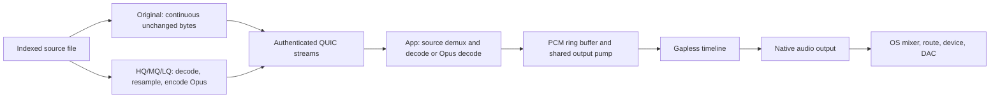

# Source-preserving Original streaming over QUIC

Original delivers unchanged bytes from the indexed source file over authenticated
QUIC. The app demuxes and decodes them at the source's sample rate and precision.
HQ, MQ and LQ retain their server-generated 160, 96 and 48 kbit/s Opus streams.
There is no Maximum profile and no fixed codec bitrate for Original.

All modes use the same native QUIC implementation, pinned server identity,
authenticated control stream, outgoing stream scheduler and QUIC flow control.
They also share the app's playback session, adaptive buffer policy, seek request
generations, PCM ring buffer, output pump and gapless timeline. The encoded
payload and codec-specific seek operations differ because Original retains the
source container and codec. It never silently falls back to HTTP or Opus.



## Experimental client path migration

`quic_allow_client_migration` is a startup-only YAML option and defaults to
`false`, including when omitted from an older configuration. The default server
continues advertising QUIC's `disable_active_migration` parameter. Keep migration
disabled until the matching native client and the user-run compatibility/device
validation in the app's network handover plan have passed.

Opting in permits client-address migration to the same server endpoint without
replacing its authenticated connection, active streams or source producers.
The server supplies random spare connection IDs and reset tokens within the
negotiated limit (at most four active server IDs), installs their dispatch routes
before announcement, and replenishes/removes IDs as they retire. Peers that never
migrate retain ordinary streaming behavior. Clients must honor the server's
transport parameter and use their buffered reconnect/resume path when migration
is prohibited, unsupported or unsuccessful.

UDP packet metadata records the actual received destination and selects the
outgoing source requested by QUIC, including wildcard listeners and mapped IPv4
on dual-stack sockets. Receive coalescing is split into bounded individual
datagrams; outgoing packets retain their original path and pacing deadline.
Scoped IPv6 link-local destinations require an explicit interface bind because
the portable receive metadata does not expose an interface index for a wildcard
listener. Arbitrary LAN/public server-address replacement is outside this
feature and requires trusted endpoint selection followed by reconnect/resume.

The migration tests exchange actual QUIC packets in memory without opening
listeners. They check stream continuity, permission compatibility, missing spare
IDs and dispatch/retirement of IDs across migration. Physical network handover
and target-platform validation remain separate release gates.

## Original wire protocol

After the existing TLS/SPKI validation and token authentication, the client sends
newline-delimited JSON on the existing bidirectional control stream:

```json
{"type":"source_open","request_id":42,"track_id":"track-id","offset":0}
```

`offset` is an unsigned 64-bit source-file byte offset. The server resolves the
track through the library; clients cannot supply filesystem paths. It opens the
file once for this sequential span and checks its identity before announcing
the stream. An asynchronous producer schedules bounded reads on tracked blocking
workers as downstream capacity becomes available, checking cancellation between
16 KiB reads and file identity before and after each published chunk and at EOF.

The control reply identifies the exact raw payload on a server-initiated
unidirectional stream:

```json
{"type":"source","request_id":42,"track_id":"track-id","stream_id":3,"offset":0,"length":9000000,"total_length":9000000,"source_version":"opaque-version"}
```

`length` is an unsigned 64-bit count equal to `total_length - offset`. It is the
length of the remaining source, not a memory allocation or cache-fill size.
That stream carries exactly `length` unmodified file bytes followed by QUIC FIN.
It has no Opus header, PCM conversion, media framing or codec padding. The first
reply establishes the file size and source version. A seek that opens another
span includes that `source_version`; replies must retain the same version and
total length. Sequential decoder reads continue consuming the existing stream
without another control request or intermediate FIN.
An EOF request returns zero payload bytes and FIN; an offset beyond EOF fails.
The client rejects mismatched offsets, sizes, versions, duplicate announcements,
excess bytes, truncation and missing final FIN. A new span generation retires the
previous stream and clears its buffered bytes so stale data cannot enter the
current decoder. An I/O failure or source change terminates the span as an error
rather than a successful short file.

The older finite `source_range` request remains supported for compatibility.
It takes a `length` from 1 to 262144 bytes and returns that bounded window plus
FIN through the same response shape. Current Original playback uses
`source_open`, so decoder cache fills are no longer serialized network requests.

The version is a hash of file identity metadata, not a checksum of the entire
file. It avoids combining ordinary replacements or modifications across ranges
without reading the full file before playback. QUIC's authenticated encryption
protects payload integrity in transit. No full-file checksum is required on
startup, and this version mechanism does not promise detection of edits that
deliberately preserve all identity metadata.

## File reads, threads and bounded memory

The server allows at most 16 Original file I/O jobs at once through a fair shared
semaphore. The limit applies to actual opens, metadata checks and reads, rather
than the lifetime of a stream. A continuous producer reserves channel capacity
before acquiring an I/O permit, so paused and prepared streams hold neither
scarce read capacity nor a sleeping blocking thread. Their file handle and
bounded queued bytes remain available for resumption. Legacy finite requests
share this I/O budget and retain their 256 KiB request limit.

A continuous producer reads 64 KiB chunks through a four-slot channel. The
reserved slot includes the chunk currently being read, so queued plus in-flight
payload stays within 256 KiB. The outgoing scheduler stages at most 64 KiB,
including partial writes, giving at most 320 KiB of source-owned payload per
connection, separately from QUIC's flow-controlled buffers. Aggregate retained
payload scales with connected clients; there is no lifetime 16-stream quota.
A connection has one current Original transfer. Superseding, disconnecting,
revoking authentication or shutting down cancels the producer, including while
its channel or I/O admission queue is full. A cancelled native I/O job retains
its permit until the physical read actually finishes.

Due transport ticks are serviced before incoming UDP packets, with missed ticks
skipped, so a busy peer cannot starve other clients' source readiness, timeouts
or authentication checks. A server stream is created in QUIC before its ID is
announced. Cancelling before the first source byte can therefore reset the
stream and return peer stream credits. If credits are temporarily exhausted,
the ready source stays owned and retries without consuming another stream ID.

Outgoing UDP packets retain QUIC's pacing timestamp and wait until that deadline
before reaching the socket. Each connection retains at most one encoded datagram,
up to 1350 bytes, in addition to the source payload and QUIC buffers above.
A future deadline on one connection does not block another connection's due
packets. The shared loop wakes for the earliest pacing deadline; after socket
backpressure it waits for writable readiness instead of repeatedly retrying an
overdue timer. Shutdown and due transport ticks retain priority over send and
receive work, and a large ready burst yields after 64 datagrams per connection.
Draining, disconnected and revoked connections discard their pending datagram.
Ordinary source supersession keeps the already encrypted packet intact, since
it can also contain control data; QUIC resets and stream generations retire its
old audio payload.

On a source connection the native client retains up to 4 MiB in a rolling byte
delivery queue. Consuming bytes frees space at the front while the network thread
fills the back. Once full, it stops draining the QUIC stream, allowing transport
backpressure to reach the server's bounded producer. Source connections advertise
4 MiB stream and 8 MiB connection flow-control windows. Opus delivery remains
512 KiB with its existing settings. Source streaming bypasses Opus media-time
buffer reports; its bounded byte and PCM buffers provide backpressure instead.

On the app, the UI isolate sends playback commands to an audio worker isolate.
Original creates a separate file decoder isolate, which owns both its native
decoder and its QUIC source reader. A Rust network thread owns the UDP socket
and QUIC connection. Native function pointers connect the existing QUIC library
to the existing decoder library; data reads do not call Dart from Rust and do
not embed a second copy of QUIC/TLS in the decoder library.

The decoder's seekable `MediaSource` starts with a 16 KiB source-byte cache fill.
Later cache misses adapt their request between 16 and 256 KiB to decoder demand.
For a contiguous offset, the native `read_range` callback consumes the next bytes
from the same continuous stream and rolling queue. Nonfinal reads return useful
available bytes when the rolling queue runs dry rather than waiting to fill the
requested capacity. Only the final read waits for the exact file boundary and
FIN. The callback's historical name does not imply a new network range request.

`Seek` changes the logical source-byte position. Cached seeks stay local; an
uncached offset discontinuity cancels the previous span and opens a new stream.
Symphonia's media-source buffer and format reader sit above that interface, so
the container can fetch headers, seek tables or an MP4 index at nonsequential
positions without downloading the whole file. Every complete native decoder read
or seek shares one fifteen-second budget across its partial fills; opening and
probing share a twenty-second budget. Positive short reads cannot renew the
complete operation indefinitely. These deadlines do not limit the total duration
of a continuously played file. A monotonic operation epoch interrupts an obsolete
read before a new seek; parent-owned cancellation can end a read before the child
processes its queued close command, without freeing its borrowed handle. Source close
cancels and joins the socket-owning thread. An OS DNS lookup can finish separately after cancellation;
that resolver owns only the address string, not a socket or credentials.

Route hints use an independent owner generation, so a network change does not
cancel an active seek or decoder operation. A hint alone does not replace a
working connection; demanded delivery stalls and transport failure trigger repair.
The stall allowance is 5–8 seconds, extended for measured RTT up to 12 seconds. Early transport repair reopens at
the unreturned source-byte offset inside the existing operation deadline. One
recovery episode shares a thirty-second monotonic budget and three connection
attempts across native retries and replacement decoders. Source version and
length remain pinned; authorization and identity rejection bypass retries.

If an error escapes a native decoder read, the app retires that parser. A read
can consume internal pending samples before a later packet fails, so retrying
the failed parser could skip audio. The file-source owner retains accepted PCM
and the shared output, then opens a fresh pinned decoder at the next presentation
frame committed to the PCM queue. Native frame seeks apply format preroll and
exact frame trimming. Lossless fixture checks require bit-exact samples; lossy
decoder resets preserve frame placement without asserting identical codec state.
An exhausted episode enters a controller-owned waiting/retry state with capped backoff, preserving the selected track, position and user intent. Pause, Stop and newer selections cancel obsolete retries.

Client cleanup also emits a best-effort QUIC connection close. On receiving a
peer close, the server immediately clears authentication, presence, pending
sources and outgoing producers. Only the transport tombstone remains during
QUIC draining; source files and queues do not wait for that deadline.

Original decoding fills the shared session media-time read-ahead horizon: eight
seconds normally, two seconds while user-paused, and three seconds for a
loopback host. Unheard gapless successors retain two seconds normally or five
seconds with a protected network profile. Unlike the compact Opus packet
cache, this read-ahead contains decoded PCM32 and is capped at 16 MiB per source.
For high sample rates, the byte cap can shorten the available media horizon.
The producer stops requesting/decoding when that buffer is full. Startup does
not wait for the whole horizon: the adaptive startup gate remains independent.

The decoder cache no longer imposes one request/round-trip per fill.
The continuous stream and 4 MiB rolling queue overlap network delivery with
decoding, while retaining explicit memory bounds. A 4 MiB stream window at
200 ms RTT represents about 168 Mbit/s of flow-control headroom before overhead,
not a guaranteed transfer rate. Actual throughput still depends on congestion,
loss, server storage, decoder speed and link bandwidth. A 192 kHz stereo PCM32
WAV needs 12.288 Mbit/s continuously; read-ahead absorbs temporary delays but
cannot compensate indefinitely for an average throughput deficit.

## Demuxing and sample conversion

Container parsing extracts codec packets from file bytes; it does not itself
change audio quality. A FLAC source is losslessly decoded, an MP3/AAC/Opus/Vorbis
source is decoded according to its existing codec, and integer PCM containers
are unpacked. Original adds no server-side lossy encode or resampling step.
Transporting an already-lossy source preserves that file; it cannot restore
information discarded when the source was originally encoded.

The native decoder exposes interleaved signed 32-bit PCM to Dart. Integer source
samples are normalized into that container: 16-bit values shift left 16 bits,
24-bit values shift left 8 bits, and 32-bit values retain their values. This
preserves supported integer source precision; it does not create extra detail.
Lossy and floating-point decoders also convert to the app's integer PCM32 output
representation, so preservation of original file bytes is the universal
transport guarantee, not an assertion that every floating-point decoding path
is bit-identical to every other decoder implementation.

Decoded PCM32 crosses from the decoder isolate to the audio worker using
`TransferableTypedData`, enters `PcmRingBuffer`, and is read in 40 ms chunks by
the common output pump. There are explicit buffer copies at file reads, QUIC
delivery, native/Dart boundaries and device submission; this is not a zero-copy
pipeline. Read-ahead and native device scheduling are separate budgets.

## Seeking

The shared seek coordinator increments a request generation, invalidates old
PCM/pump work, accounts for samples already rendered, pauses and flushes output,
and waits for readiness of the new position. A newer seek supersedes the older
one, and the coordinator has its existing five-second readiness deadline.

For Original, the container reader maps the requested timestamp to source-file
byte positions, using its index or bounded codec preroll. An uncached byte seek
reopens the continuous QUIC span at that offset. The codec is reset, preroll is
decoded and discarded, and the requested audible samples resume through the same PCM pump.
The file's source version remains pinned across those reads.

For HQ/MQ/LQ, the app first looks for a usable retained encoded range. Otherwise
it sends the existing timestamp-based `seek` control command; the server produces
the relevant Opus time range, and the client trims decoder/encoder preroll.
Codec-specific seeking differs while user intent, cancellation, output flushing
and readiness accounting share the same coordinator.

## HQ/MQ/LQ server conversion

These modes keep the existing five-second cached time ranges and four producer
slots. A cache miss launches an isolated range worker. That worker opens and
demuxes the source, decodes it, converts samples to signed 16-bit PCM, resamples
to 48 kHz when needed, and encodes Opus at the selected 160/96/48 kbit/s target.
The ordinary request uses 20 ms Opus frames. The worker's framed pipe output
fills the server's range cache; an existing rendition can be shared or replayed.

The QUIC audio stream carries an `OPUSR01` header and length-prefixed packets.
The header provides sample rate, channels, frame duration, target bitrate,
encoder pre-skip, track metadata and an exact audible-frame extension where
available. The client incrementally parses those bytes, retains bounded encoded
ranges, decodes Opus to PCM16, discards priming samples and trims final padding.
Adjacent server ranges use preroll and exact sample counts to avoid replaying
or dropping audible audio at boundaries.

## Negotiated Auto ranges

`/api/server/capabilities` advertises `adaptive_audio_ranges: true`. A capable
client explicitly requests `adaptive_ranges: true` with `mode: "auto"` on the
QUIC `open` command. The server acknowledges acceptance with `adaptive_ranges`
on every `stream` announcement. Missing/false flags retain legacy fixed-quality
behavior. An old client never opts in; an old server ignores the new open field.

Auto begins at 96 kbit/s. Buffer reports below three seconds after a five-second
cooldown reduce the desired rendition one level (160/96/48 kbit/s). A reserve
of 8–12 seconds, according to the requested horizon, must remain healthy for
thirty seconds before upgrading one level. Intentionally small paused/prepared
horizons do not drive adaptation. New independently encoded five-second ranges
use the selected quality; in-flight ranges retain their original encoder and
cache key. Renditions remain isolated by quality. The client validates the
source identity and output format while permitting negotiated bitrate changes,
then applies each range's preroll and exact presentation trimming as usual.
Original and manually selected HQ/MQ/LQ retain their requested quality.

## Poor-network verification

These are user-run physical-device checks. Compilation and listener-free tests
can run independently; agents do not start the app, a simulator or the server.
Keep the phone locked and test both the selected track and automatic next song
through wired CarPlay. Preserve iPhone and matching server logs, including
`PHONOLITE_PROFILE=1` transport samples when investigating throughput.

| Scenario | In/out bandwidth (kbps) | In/out delay | In/out packet loss | Expected behavior |
| --- | --- | --- | --- | --- |
| Latency and loss with ample bandwidth | 50000 / 50000 | 300 / 300 ms | 3% / 3% | Buffer as needed; avoid reconnecting for short stalls; recover without app restart |
| Limited cellular capacity | 256 / 128 | 150 / 150 ms | 1% / 1% | Auto can reduce rendition quality; Original preserves its selected source |
| Brief outage | Retain prior limits | Retain prior delay | 100% / 100% for 5–10 s, then restore | Keep track/position/intent and resume automatically |
| Recovery and cancellation | Restore normal profile | 0 / 0 ms | 0% / 0% | Pause/Stop/new track overrides pending repair; artwork arrival cannot restart audio |

Vary profiles during playback rather than relying only on one steady condition.
Check that a cover request which never completes cannot delay source preparation.
Original still requires adequate average useful bandwidth for its source bitrate;
buffering absorbs interruptions but cannot overcome a sustained throughput deficit.

## Gapless and the physical output

The gapless worker prepares a successor source and its decoder while the current
source is audible. Prepared audio cannot render until its source lease becomes
active. Compatible formats feed the same native device sequentially; frame spans
attribute native completion callbacks to the correct track. Queue advancement,
listening attribution and now-playing changes follow consumed device samples,
not network delivery or successful enqueue calls.

The common timeline limits native scheduling to a 125 ms threshold before the
next 40 ms chunk is submitted (roughly 125-165 ms queued in practice). This is
separate from the multi-second app read-ahead. A scheduling stall can therefore
starve the native output even when source data remains buffered. A five-second
output-progress deadline turns an unresponsive output into a playback failure
instead of an endless wait; progress calls also have a bounded response time.
No-progress accounting is suspended while the user or device is intentionally
paused. Opus delivery has a separate
fifteen-second idle deadline while more network audio is expected; intentional
pause and read-ahead backpressure do not count as a transport stall.

Seeks retain the requested playback occurrence across asynchronous cancellation.
They join targeted releases, then cancel any remaining preparations, and replace
the ordinary cancellation rewind with the requested target. An older command
cannot move a newly selected track or override a newer seek. Pause continuations
also check the latest intent before publishing state or pausing more sources.

Both native and server MP4 decoders honor supported single unit-rate presentation
edits, including AAC priming and final padding. Unsupported edit patterns fail
explicitly. Vorbis seeks account for overlap-primer duration when a priming packet
produces no PCM. Opus stream/rendition keys and durable completion markers include
the revised presentation policy so earlier padded encodings are not reused.
Stored library durations use the existing full-rescan path to refresh old tags;
range bounds already use the source's corrected presentation frame count.

Owned transports have native finalizers and a ten-second owner lease as cleanup
fallbacks after forced Dart worker termination. Normal close cancels promptly;
hostname resolution is cancellable for Original and HQ/MQ/LQ. An OS lookup helper
may finish later, but retains no socket or credentials. Legacy unowned C callers
do not acquire a new lease expiry implicitly.

With seamless mixed-format conversion disabled, Original preserves the selected
source rate/precision at the app output boundary. Incompatible successor formats
must drain and reopen the native output; that transition may have a gap. Enabling
the conversion setting deliberately resamples/rechannels into the persistent
output format to avoid that renegotiation. Exact native-rate preservation and
continuous output across incompatible hardware formats cannot both be assumed.

On Windows, the output adapter submits buffers to XAudio2. On iOS, it submits
PCM buffers to AudioQueue with a source-rate `AudioStreamBasicDescription` and
activates the playback `AVAudioSession`. Volume is applied by the output backend.
The OS mixer and selected route can resample, adjust volume or otherwise convert
audio. Wired/wireless CarPlay, Bluetooth, the head unit's DSP and DAC are outside
the app's source-byte preservation guarantee. Source-preserving transport does
not imply identical physical output on every route.

## Compatibility and verification

The app and native transport/decoder libraries must be rebuilt with the server.
An older server that lacks `source_open` fails the bounded request; the client
does not switch transport or transcode Original to make it play. Offline download
quality remains independent and unchanged.

Codec-seek and Apple playback-clock accounting fixes are implemented alongside
these changes. Native tests cover codec seek boundaries, but an iOS build and
CarPlay device validation remain outstanding in this environment.

## Original-file HTTP endpoint

`GET /api/stream/:track_id/original` delivers the indexed source file unchanged.
It uses the same authenticated API boundary as downloads. No Opus encoder,
resampling or PCM conversion runs on the server for this endpoint.

The response includes the source MIME type, `Content-Length`, `Accept-Ranges:
bytes`, a source-version `ETag`, and `Content-Disposition: inline`. `HEAD` returns
the same metadata without an audio body. A single HTTP byte range produces
`206 Partial Content` and `Content-Range`; an invalid or unsatisfiable range
produces an empty `416` response with `Content-Range: bytes */<file size>`.
Matching `If-Range` requests preserve their range. A stale validator returns
the complete current source with status `200`, so clients must detect a changed
source before combining cached ranges.

Original-file delivery does not calculate a complete file checksum before responding.
The download endpoint retains its attachment, checksum and range behavior through
the same file-response implementation. HQ, MQ and LQ continue using their
existing Opus settings. The app's Original streaming mode does not use this HTTP
endpoint, which remains available for compatible clients requesting source bytes.

Source sample rate and sample precision are determined by the client decoder.
Returning original bytes does not itself guarantee a particular device's output
format. Clients must report unsupported source or output formats instead of
silently substituting a compressed quality.

Run the listener-free quality and delivery checks with:

```powershell
cargo test -p server --no-default-features --test original_quic_source_test
cargo test -p server --bin phonolite-server quic::streaming_tests::
cargo test -p server --no-default-features --test original_file_streaming_test
```
